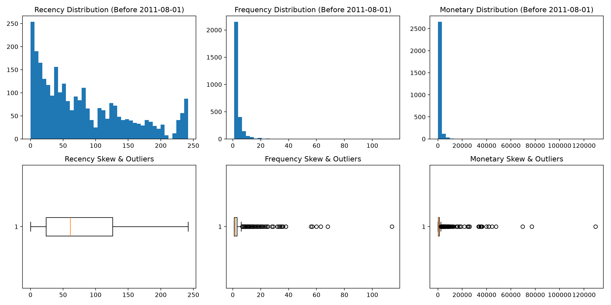
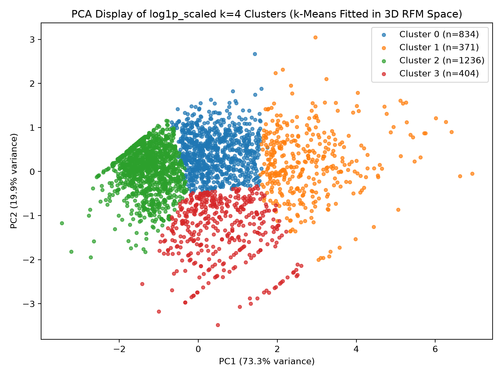

# Customer Segmentation and Contact Priorities for a UK Online Retailer
**Course:** Programming for AI (BS Artificial Intelligence) — Assignment No. 3 (Complex Computing Problem)  
**Institution:** Riphah International University, Faculty of Computing  
**Student:** Ukash Irfan Malik  
**Dataset:** UCI Online Retail (DOI: `10.24432/C5BW33`, CC BY 4.0)  
**Git Freeze Reference:** Commit `be117a85038275638151e82192c6eee561b37420` (`be117a8`)

---

## One-Page Management Summary

### Decision Context and Scope
An online retailer wants to prioritize customer outreach under a strict operational limit of $B = \min(200, \lfloor 0.10 \times N \rfloor)$ distinct contacts per cycle at £2 per contact (maximum £400). Using the UCI Online Retail dataset (541,909 raw transactions from 1 December 2010 to 9 December 2011; SHA256 `43465a06f2ccf7c8b5bd2892bc7defb52f97487934fe93b16ae4c3936424676d`), we restricted analysis strictly to **United Kingdom** transactions ($495,478$ rows) and filtered to valid positive merchandise purchases ($348,902$ rows totaling $£7,244,330.32$) prior to two chronological cutoffs: **1 August 2011** ($N = 2,845$ eligible customers) for development and **1 September 2011** ($N = 2,986$ eligible customers) for untouched final evaluation.

### Key Analytical Findings
1. **Feature Representation & Clustering (`Part C`):** Standardizing raw RFM features produced extreme cluster imbalance (`k = 2` achieved a `0.8729` silhouette by isolating just `24` extreme spenders from `2,821` customers). Applying `log1p` transformation followed by `StandardScaler` with $k = 4$ (`random_state=42`, `n_init=20`) yielded four interpretable, balanced segments (silhouette `0.3760`, inertia `2560.9134`) with high seed stability ($\text{ARI} = 0.9986\text{–}1.0000$ across seeds `1, 10, 21, 42, 100`).
2. **Development vs. Untouched Final Comparison (`Part D`):** Both policies selected exactly $B = 200$ unique customers at a total cost of $£400.00$. However, across both evaluation windows, the simple top-`Monetary` baseline substantially outperformed the equal-quota cluster policy on immediate repeat purchasing and revenue capture:

| Stage & Evaluation Month | Policy | Contacts ($B$) | Cost (£) | Repeat Purchase Rate | Spend / Selected (£) | Captured Spend Share | Cohort Coverage |
| --- | --- | --- | --- | --- | --- | --- | --- |
| Development (Aug 2011) | `baseline_monetary` | 200 | £400.00 | 73.5% | £1,132.53 | 51.76% | 7.03% (200 / 2,845) |
| Development (Aug 2011) | `cluster_policy` | 200 | £400.00 | 41.0% | £575.16 | 26.29% | 7.03% (200 / 2,845) |
| Final Assessment (Sep 2011) | `baseline_monetary` | 200 | £400.00 | 74.0% | £1,688.42 | 51.62% | 6.70% (200 / 2,986) |
| Final Assessment (Sep 2011) | `cluster_policy` | 200 | £400.00 | 45.0% | £1,239.50 | 37.89% | 6.70% (200 / 2,986) |

### Recommendation and Causal Caveat
- **Primary Recommendation:** Adopt the **Top-Monetary Baseline** for immediate outreach revenue efficiency, and run a **limited randomized A/B pilot** before deploying cluster-quota outreach in production.
- **Why:** Equal-quota clustering successfully broadens segment representation (`50` contacts across all four UK customer archetypes), but reserving slots for dormant and low-frequency segments sacrifices `£448.93` per contact in September spend (`£1,239.50` vs. `£1,688.42`). Furthermore, because no historical contact treatments or control groups exist in the dataset, higher repeat purchasing reflects historical buying persistence rather than proven causal outreach lift.

---

## 1. Problem Definition, Stakeholders, and Workflow (Part A)

### 1.1 Main Decision Question and Eligibility Rules
**Decision Question:** For identified United Kingdom customers with at least one valid positive merchandise purchase before a cutoff date $C$, does segmenting customers with scaled RFM `k-Means` clustering and allocating outreach quotas across clusters improve subsequent-month repeat purchasing and captured positive purchase value enough within $B = \min(200, \lfloor 0.10 \times N \rfloor)$ contacts (£400 cap) to justify deploying a cluster-based policy over a simple top-Monetary baseline?

**Eligibility Rules:**
- **Geography:** Only `Country == "United Kingdom"` records are retained; conclusions apply exclusively to the UK market.
- **Customer Identity:** `CustomerID` must be non-null so invoices aggregate reliably to individual accounts.
- **Temporal Cutoff:** Only transactions strictly before midnight at cutoff $C$ (`InvoiceDate < C`) enter feature construction.
- **Valid Positive Purchase:** `Quantity > 0`, `UnitPrice > 0`, `InvoiceNo` not starting with `"C"`, non-merchandise stock codes (`POST`, `D`, `M`, `BANK CHARGES`, `PADS`, `DOT`, `CRUK`, `B`) excluded, and exact duplicate rows removed.

### 1.2 Measurable Objective, Coverage, and Acceptance Criteria
- **Priority Objective:** Maximize post-cutoff monthly positive purchase value per contacted customer (GBP), captured share of eligible cohort positive spend, and repeat purchase rate ($\ge 1$ valid positive invoice in the evaluation month) within $\text{Cost} = 2B \le £400$.
- **Coverage Measure:** Track both **cohort coverage** ($B / N_{\text{cohort}}$: `7.03%` at August cutoff, `6.70%` at September cutoff) and **segment representation coverage** (number of behavioral clusters receiving allocated slots).
- **Inherent Conflict:** Focusing all $B$ contacts on highest historical spenders maximizes expected short-term GBP per contact, whereas enforcing multi-cluster representation reserves slots for lower-spending or dormant segments, lowering immediate expected spend per contact.
- **Acceptance Criteria:** (1) Deterministic reproducibility from raw SHA256-verified Excel input; (2) exact $B$ unique eligible contacts within £400 with deterministic `CustomerID` tie-breaking and per-row reasons; (3) zero future information leakage and Git procedure freeze before September evaluation; (4) verified `joblib` bundle persistence with explicit validation failures on malformed inputs.

### 1.3 Unsupervised Grouping vs. Supervised Prediction
Unlike supervised learning—where historical outcomes $y$ (such as known campaign responses) train a classifier or regressor directly—this dataset contains no ground-truth outreach labels. Unsupervised `k-Means` discovers geometric groupings in scaled RFM space without target supervision; subsequent-month transactions serve strictly as an external business benchmark to compare candidate decision policies.

### 1.4 Stakeholder Analysis and Conflict Resolution

| Stakeholder | Primary Goal | Key Concern | Conflict & Design Resolution |
| --- | --- | --- | --- |
| **Sales** | Maximize immediate order revenue by contacting highest spenders. | High GBP per contacted customer and revenue share. | Conflicts with Account Managers' diversity goal; resolved within each cluster by ranking via `Monetary / (1 + Recency)` and benchmarking directly against a pure top-Monetary baseline. |
| **Account Managers** | Engage diverse customer archetypes (loyalists, recent buyers, dormant accounts). | Representation across all $k$ behavioral clusters. | Conflicts with Sales' revenue concentration; resolved via equal inter-cluster quotas ($\lfloor B/k \rfloor$ with largest-remainder rounding and spare-slot reallocation). |
| **Finance** | Enforce strict budget caps and verify ROI over simple heuristics. | Contact cost $\le £400$ ($B \le 200$) and baseline comparison. | Hard-coded budget cap $B = \min(200, \lfloor 0.10 \times N \rfloor)$ with automated cost assertions and side-by-side baseline evaluation. |
| **Customers** | Receive relevant outreach matched to buying cadence without spam. | Contact frequency and data privacy. | Single ranked contact list per cycle ($B \le 200$), non-merchandise noise removed, and outputs keyed strictly by internal `CustomerID`. |

### 1.5 Assumptions, Scope Limits, and Information Leakage Controls
- **What Data Answers:** Historical UK purchase cadence, invoice frequency, gross positive spend, cluster stability, and untouched post-cutoff purchase rates.
- **What Requires Business Confirmation:** Product profit margins, net impact of returns on account profitability, exact outreach channel mechanics (£2 unit cost), and causal response lift via randomized testing.
- **When Not to Deploy:** Do not deploy cluster-quota outreach for immediate revenue maximization if it underperforms the top-Monetary baseline without an explicit retention/experimentation mandate, or if $N$ shrinks so small that $\lfloor 0.10 \times N \rfloor$ cannot meaningfully populate $k$ clusters.
- **Workflow Dependencies & Leakage Gates:**
  1. *Raw Audit & SHA256 Check* $\rightarrow$ *UK & Valid Positive Filtering* $\rightarrow$ *Cutoff-Strict RFM (`InvoiceDate < C`)* (**Gate 1:** prevents post-cutoff purchase leakage).
  2. *Development Scaling & k-Means (`< 2011-08-01`)* $\rightarrow$ *August Policy Comparison* $\rightarrow$ *Git Commit Freeze (`be117a8`)* (**Gate 2:** prevents fitting scalers on future data or post-hoc tuning on September outcomes).
  3. *September Cohort Evaluation (`2011-09-01` to `< 2011-10-01`)* excludes customers whose first-ever purchase occurred in September (**Gate 3:** prevents new-customer denominator distortion).

---

## 2. Data Audit and Customer Feature Engineering (Part B)

### 2.1 Reconciled Audit Summary (`Online Retail.xlsx`)
The unchanged local Excel file was downloaded on `2026-11-24` with SHA256 `43465a06f2ccf7c8b5bd2892bc7defb52f97487934fe93b16ae4c3936424676d`. Because individual rows can trigger multiple exclusion flags (for example, a cancelled invoice may also have negative quantity), each flag was audited separately and combined via a single boolean conjunction so valid rows are reconciled without double-counting:

| Audit Stage | Row Count | Line Value (GBP) | Analytical Treatment |
| --- | --- | --- | --- |
| `0_raw_all_countries` | 541,909 | £9,747,747.93 | Complete UCI raw dataset |
| `1_uk_only` | 495,478 | £8,187,806.36 | Retained UK geographic scope (`46,431` non-UK rows excluded) |
| `2_cancellations_C` | 7,856 | -£815,291.60 | Logged separately in `cancellations_audit.csv`; excluded from gross positive Monetary |
| `3_missing_CustomerID` | 133,600 | £1,419,932.97 | Unattributable guest/POS lines; counted and reported before exclusion |
| `4_zero_or_negative_qty_or_price` | 10,355 | -£837,415.72 | Zero-price adjustments and negative quantities excluded |
| `5_non_merchandise_stockcode` | 1,467 | £108,497.16 | Excluded `POST`, `D`, `M`, `BANK CHARGES`, `PADS`, `DOT`, `CRUK`, `B` |
| `6_exact_duplicates` | 5,178 | £20,678.18 | Deduplicated keeping first occurrence |
| `7_valid_positive_uk_txns` | **348,902** | **£7,244,330.32** | Clean valid positive UK transactions used for cutoff RFM aggregation |

### 2.2 RFM Feature Definitions and Identifier Exclusions
- **Recency (days):** Whole days elapsed from the customer's latest valid positive invoice before cutoff $C$ to midnight at $C$ (`Recency >= 0`).
- **Frequency (invoices):** Count of distinct valid positive `InvoiceNo` values before $C$ (`Frequency >= 1`).
- **Monetary (GBP):** Gross sum of `Quantity * UnitPrice` across valid positive lines before $C$ (`Monetary > 0`).
- **Why Identifiers & Country Are Excluded From Clustering:** `InvoiceNo` and `CustomerID` are nominal keys whose numeric digits carry no behavioral similarity; `Country` is constant (`United Kingdom`) after geographic filtering.

### 2.3 Distributional Skew and Manual Verification Checks
Summary plots (`figures/rfm_dev_distributions.png`) confirm strong right-skewness across `Frequency` and `Monetary` alongside heavy upper-tail outliers, motivating logarithmic compression prior to Euclidean distance clustering.

Two customer histories before `2011-08-01` were manually audited against `build_rfm_at_cutoff()`:
1. **CustomerID `12747` (with cancellation history):** Excluded `1` cancelled row (`cancellations_audit.csv`); verified `Recency = 33` days, `Frequency = 7` valid invoices, and `Monetary = £2,777.06`—matching the automated RFM output exactly.
2. **CustomerID `12748` (clean valid history):** Verified `Recency = 0` days, `Frequency = 76` valid invoices, and `Monetary = £11,458.57` (`0` excluded cancellation rows)—matching the automated RFM output exactly.

---

## 3. Clustering Investigation and Design Selection (Part C)

### 3.1 Candidate Representation and `k` Comparison (Development `< 2011-08-01`, $N = 2,845$)
We compared `StandardScaler` on raw RFM (`raw_scaled`) against `StandardScaler` after `log1p` (`log1p_scaled`) across $k \in \{2, 3, 4, 5, 6\}$ using `random_state=42` and `n_init=20`. Inertia is compared strictly within each representation because `raw_scaled` and `log1p_scaled` operate on different coordinate scales:

| Representation | $k$ | Inertia (Within-Space) | Silhouette | Min Cluster Size | Max Cluster Size | Cluster Size Breakdown |
| --- | --- | --- | --- | --- | --- | --- |
| `raw_scaled` | 2 | 5,847.50 | 0.8729 | 24 | 2,821 | `{0: 2821, 1: 24}` |
| `raw_scaled` | 3 | 3,584.54 | 0.5062 | 24 | 1,834 | `{0: 1834, 1: 987, 2: 24}` |
| `raw_scaled` | 4 | 2,750.60 | 0.5296 | 21 | 1,669 | `{0: 21, 1: 954, 2: 201, 3: 1669}` |
| `raw_scaled` | 5 | 2,134.27 | 0.5273 | 3 | 1,659 | `{0: 945, 1: 217, 2: 21, 3: 3, 4: 1659}` |
| `raw_scaled` | 6 | 1,756.76 | 0.4519 | 3 | 1,295 | `{0: 1295, 1: 848, 2: 21, 3: 197, 4: 481, 5: 3}` |
| `log1p_scaled` | 2 | 4,356.47 | 0.4539 | 900 | 1,945 | `{0: 900, 1: 1945}` |
| `log1p_scaled` | 3 | 3,270.68 | 0.3543 | 444 | 1,295 | `{0: 1295, 1: 444, 2: 1106}` |
| **`log1p_scaled`** | **4** | **2,560.91** | **0.3760** | **371** | **1,236** | **`{0: 834, 1: 371, 2: 1236, 3: 404}`** |
| `log1p_scaled` | 5 | 2,203.36 | 0.3357 | 184 | 1,082 | `{0: 352, 1: 476, 2: 1082, 3: 751, 4: 184}` |
| `log1p_scaled` | 6 | 1,934.94 | 0.3287 | 180 | 982 | `{0: 428, 1: 982, 2: 211, 3: 180, 4: 354, 5: 690}` |

### 3.2 Shortlisted Original-Unit Profiles (Means vs. Medians)
Comparing `log1p_scaled` at $k = 3$ vs. $k = 4$ demonstrates why $k = 4$ separates recent one-time/low-frequency newcomers from dormant one-time buyers:

| Cluster ($k=4$) | Count | Share | Recency Mean / Median (d) | Frequency Mean / Median | Monetary Mean / Median (£) | Segment Interpretation |
| --- | --- | --- | --- | --- | --- | --- |
| **0** | 834 | 29.3% | 69.9 / 58.5 | 3.13 / 3.0 | £1,203.82 / £939.24 | Mid-tier regular buyers |
| **1** | 371 | 13.0% | 16.9 / 12.0 | 11.26 / 8.0 | £5,733.95 / £2,997.75 | High-frequency loyalists |
| **2** | 1,236 | 43.4% | 130.8 / 126.0 | 1.15 / 1.0 | £267.04 / £237.04 | Dormant low-spend buyers |
| **3** | 404 | 14.2% | 11.4 / 10.0 | 2.25 / 2.0 | £618.31 / £486.92 | Recent active low-frequency |

*(At $k = 3$, Cluster 3 merges into adjacent groups, hiding recent low-frequency buyers from Account Managers.)*

### 3.3 Seed Stability, Sensitivity Study, and PCA Display
- **Seed Stability (`log1p_scaled`, $k = 4$):** Adjusted Rand Index (ARI) vs. `random_state=42` was `0.9986` for seeds `1` and `100`, and `1.0000` for seeds `10`, `21`, and `42`. High seed ARI confirms optimizer convergence on a fixed feature table, though it does not prove external predictive validity—which requires temporal out-of-sample testing.
- **Sensitivity Study (Monetary Outlier Capping):** Capping `Monetary` at the 99th development percentile (`£11,495.04`) yielded silhouette `0.3785` and inertia `2,529.78` with nearly identical cluster sizes (`{397, 838, 374, 1236}`). Retaining uncapped `Monetary` after `log1p` preserves true spend differentiation for ranking top accounts without distorting centroid geometry.
- **PCA Visualization:** `k-Means` was fitted strictly in the 3D `log1p_scaled` RFM space; 2D PCA (`figures/pca_dev_clusters.png`) was used solely to project the fitted clusters onto the top two principal components.

### 3.4 Selection Decision and Git Freeze
- **Selected Design:** `log1p_scaled` with $k = 4$, `random_state=42`, `n_init=20`.
- **Rejected Alternative:** `raw_scaled` ($k = 2$, silhouette `0.8729`) was rejected because isolating `24` extreme accounts leaves `99.2%` of customers unsegmented.
- **Git Freeze:** Committed prior to inspecting September outcomes under Git commit `be117a85038275638151e82192c6eee561b37420`.

---

## 4. Contact Policy Design and Temporal Evaluation (Part D)

### 4.1 Policy Rules and Baseline Comparison
- **Capacity:** $B = \min(200, \lfloor 0.10 \times N \rfloor) = 200$ contacts at £2/contact (£400.00 total).
- **Cluster Policy:** Equal target quotas across $k = 4$ clusters (`50` slots each), with spare-slot reallocation if any cluster is smaller than its quota. Within each cluster, customers are ranked descending by $\text{PriorityScore} = \text{Monetary} / (1 + \text{Recency})$ with deterministic tie-breaking (`Frequency` desc, `Monetary` desc, `CustomerID` asc).
- **Baseline Policy:** Top $B = 200$ eligible customers ranked by past `Monetary` descending, tie-broken by `CustomerID` ascending.

### 4.2 Development (August) vs. Untouched Final (September) Outcomes
In the September final assessment ($N = 2,986$), `cluster_policy` selected exactly `50` customers from each of Clusters `0, 1, 2, 3` (`200` unique customers, £400.00 cost), whereas `baseline_monetary` concentrated nearly all `200` slots in high-spend Cluster 1 accounts:
- **Repeat Purchase Rate:** `74.0%` (`baseline_monetary`) vs. `45.0%` (`cluster_policy`).
- **Positive Spend per Selected Customer:** `£1,688.42` (`baseline_monetary`) vs. `£1,239.50` (`cluster_policy`).
- **Share of Eligible Cohort September Spend Captured:** `51.62%` (`baseline_monetary`) vs. `37.89%` (`cluster_policy`).
- **Business Tradeoff Example:** Reserving `50` contacts for dormant Cluster 2 accounts (`mean Recency = 149.6 days`, `mean Monetary = £262.81`) and `50` for recent low-frequency Cluster 3 accounts (`mean Monetary = £669.49`) provides multi-segment coverage for Account Managers but lowers immediate revenue capture by `£448.93` per contacted customer compared to the baseline.

### 4.3 Causal Limitations and Controlled Pilot Design
Because the dataset contains no record of actual customer outreach or randomized control assignments, September repeat purchases measure historical persistence rather than causal treatment uplift. Management should deploy the **Top-Monetary Baseline** for immediate revenue capture while running a randomized 50/50 holdout A/B pilot across clusters to measure true incremental response lift net of returns.

---

## 5. Software Persistence and Verification (Part E)

The final September preprocessing pipeline (`log1p_scaled`), `KMeans(n_clusters=4)` model, ordered feature schema (`['Recency', 'Frequency', 'Monetary']`), units, eligibility rules, quota policy, and package versions were saved to `models/final_workflow_bundle.joblib`. Automated verification confirmed:
1. Reloading the bundle reproduces identical cluster assignments across all `2,986` September customers (`np.array_equal` passed).
2. The ranked contact list contains `200` unique eligible customers (`£400.00` cost) with zero future leakage.
3. A newly prepared customer row (`Recency=14, Frequency=3, Monetary=240.0`) was assigned to `Cluster 3` without retraining.
4. Malformed inputs—missing `Monetary` column and negative `Recency=-5`—raised explicit `ValueError` exceptions rather than silently imputing or reordering columns.

---

## References
1. Seoul Accord. *Section D Graduate Attributes, D.4.1 and D.5*. Accessed 13 November 2026.
2. Chen, D. *Online Retail*. UCI Machine Learning Repository. `https://doi.org/10.24432/C5BW33`. Dataset page `https://archive.ics.uci.edu/dataset/352/online+retail`. CC BY 4.0. Accessed 24 November 2026.
3. Pedregosa et al. *Scikit-learn: Machine Learning in Python*, JMLR 12, pp. 2825–2830, 2011 (`KMeans`, `StandardScaler`, `PCA`, `silhouette_score`, `adjusted_rand_score`).

---

## Appendix: Individual Reflections (40–60 Words Each) & AI Log

- **Question A (47 words):** While Sales prioritizes top spenders to maximize immediate order revenue, Account Managers require segment diversity across different buying patterns. A highest-spending customer may already purchase organically without outreach or represent a single bulk outlier, whereas allocating our 200-contact budget across clusters balances retention, reactivation, and multi-segment coverage.
- **Question B (47 words):** Removing InvoiceNo rows starting with 'C' means Monetary represents gross positive merchandise purchases rather than net revenue after returns. In our UK audit, 7,856 cancellation lines totaled -£815,291.60 compared to £7,244,330.32 in valid positive sales. Stating this distinction prevents stakeholders from mistaking gross sales for net profit.
- **Question C (45 words):** Although raw_scaled k=2 achieved a 0.8729 silhouette, it isolated just 24 extreme spenders into one cluster and lumped 2,821 customers together, giving Account Managers unusable segments. I chose log1p_scaled k=4 (silhouette 0.3760) because it produced four balanced, seed-stable groups (ARI 0.9986-1.0000) supporting actionable multi-segment quotas.
- **Question D (51 words):** Higher September repeat purchasing (74.0% for baseline versus 45.0% for cluster policy) reflects natural buying persistence among frequent high spenders, not proof that outreach caused those orders. Because the UCI dataset records no actual contact treatments or randomized holdout control group, causal sales uplift cannot be claimed without an A/B pilot.
- **Question E (46 words):** k-Means assigns clusters using Euclidean distances to stored centroids in the exact scaled feature space learned during training. If StandardScaler parameters shift or RFM definitions change—such as subtracting returns from Monetary or altering Recency units—incoming coordinates misalign with saved centroids, producing inconsistent or incorrect group assignments.